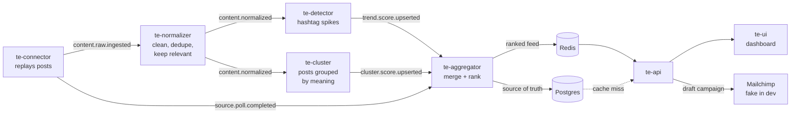

# Trends Engine

Spots marketing trends in social posts as they emerge, and turns a trend into a
draft Mailchimp campaign in one click.

This repo is a working proof of concept: seven small services, plus the shared
infrastructure, end-to-end tests and one place to run it all. Everything runs
in Docker. You don't need Python or Node installed.

## How it works



1. **te-connector** stands in for the social-media crawlers. It replays a
   fixture of posts from X, Reddit, Instagram and TikTok on a timer, one batch
   per poll.
2. **te-normalizer** cleans each post, drops duplicates and off-topic posts,
   tags the rest with a marketing category, and archives everything.
3. Two detectors work in parallel. **te-detector** finds hashtags that jump
   well above their own usual level. **te-cluster** groups posts by meaning, so
   it also catches trends that have no hashtag.
4. **te-aggregator** merges the two signals, ranks the top trends, names and
   summarizes them, and publishes the feed to Postgres and Redis.
5. **te-api** serves the feed from Redis, falls back to Postgres, and creates
   draft Mailchimp campaigns. **te-ui** is the marketer's dashboard.

Services talk only through RabbitMQ (topic exchange `trends.topic`) and the
shared Postgres and Redis.

## Repository layout

```
trends-engine/
├── Makefile            run everything from here: make up, make logs, make test …
├── te-deployment/      docker-compose.yml for the whole stack + the Makefile behind the root one
├── te-infra/           Postgres schema, RabbitMQ queues, fake Mailchimp API, smoke test
├── te-connector/       fixture replay → content.raw.ingested   (+ fixtures and their generators)
├── te-normalizer/      cleanup, dedup, relevance + category      → content.normalized
├── te-detector/        hashtag velocity                          → trend.score.upserted
├── te-cluster/         semantic clustering (MiniLM embeddings)   → cluster.score.upserted
├── te-aggregator/      merge, rank, name, publish the feed
├── te-api/             HTTP API: feed, trend detail, Mailchimp drafts
├── te-ui/              React + TypeScript dashboard (served by nginx)
└── tests/e2e/          cross-service scenarios against the running stack
```

Every service folder has the same shape:

| Path | What it is |
|---|---|
| `README.md` | What the service does, its settings and its design choices |
| `<package>/` | The code: `connector/`, `normalizer/`, `detector/`, … |
| `tests/unit/`, `tests/integration/` | Unit tests (no infra) and integration tests (real Postgres/RabbitMQ/Redis) |
| `Dockerfile` | One image for the service and its tests |
| `Makefile` | Shortcuts for this one service (`make start`, `make test-unit`, …) |
| `requirements.txt` | Pinned dependencies; the code is stdlib Python wherever possible |

## Getting started

**You need:** Docker Desktop (with `docker-compose`) and `make`.

```
git clone <this repo> trends-engine
cd trends-engine
make up
```

The first `make up` builds every image. That takes a few minutes, mostly
downloading the CPU build of PyTorch for the two services that use the
embedding model. Later runs are quick.

Then open:

| What | Where |
|---|---|
| Dashboard | http://localhost:3000 |
| API | http://localhost:8080/v1/trends |
| RabbitMQ admin (user `trends`, password `trends_dev_pw`) | http://localhost:15672 |
| Fake Mailchimp API | http://localhost:8090/3.0 |
| Postgres / Redis | localhost:5432 / localhost:6379 |

The connector starts replaying as soon as it's up, so trends begin to appear
after a few minutes.

## Everyday commands

Run these from the repo root. They're the same as `make -C te-deployment …`.

| Command | What it does |
|---|---|
| `make up` | Build what changed and start everything (infra first) |
| `make up v2` | Same, replaying the larger 5-day fixture (generated on first use) |
| `make down` | Stop everything; data is kept |
| `make reset` | Stop everything **and wipe all data** (Postgres, RabbitMQ, Redis) |
| `make restart` | `down` + `up` |
| `make status` | What's running |
| `make logs` | Follow all logs |
| `make logs poller aggregator` | Follow some services, interleaved; add `TAIL=500` for more history |
| `make up-te-api` / `down-…` / `restart-…` | One service (any `te-*`, or `te-infra`) |
| `make help` | Every target |

Short names for `make logs`: `poller` (te-connector), `normalizer`,
`detector`, `cluster`, `aggregator`, `api`, `ui`, `infra` (or `postgres`,
`redis`, `rabbitmq`, `mailchimp`), and `all`.

## Test data

There are no real crawlers. te-connector replays synthetic posts, written to
read like real ones, with a ground-truth label for each post (trend,
evergreen or noise) kept in a separate file.

| | v1 (default) | v2 |
|---|---|---|
| File | `te-connector/fixtures/raw_content.jsonl` | `raw_content_v2.jsonl` (not committed) |
| Size | ~1,450 posts, one day | ~41,000 posts, five days |
| Mix | 7 trends, plus noise and duplicates | Mostly noise (~76%) and evergreen talk (~14%); trends ~6%; spam, look-alikes, a bot-amplified giveaway, non-English posts |
| Replay | 5 posts / 30 s, loops | 500 posts / 30 s (~40 min), one pass |
| Start with | `make up` | `make reset` then `make up v2` |
| Regenerate | `make fixtures` | `make fixtures-v2` (starts at midnight UTC yesterday) |

The e2e tests always use v1. Dedup is permanent, so to replay a fixture again,
`make reset` first.

## Tests

Every test runs in a container.

| Command | What it runs |
|---|---|
| `make test-unit` | Every service's unit tests (no infra needed) |
| `make test-integration` | te-infra smoke test + every service's integration tests |
| `make e2e` | End-to-end scenarios on the running stack, with your current data |
| `make test-e2e` | `make reset`, then e2e, then stop the stack if it passed |
| `make test` | All of the above |
| `make test-unit-te-api` (etc.) | One service |

The e2e suite (`tests/e2e/`) replays the v1 fixture through the real stack and
checks the ranked feed, the Redis-miss fallback to Postgres, the aggregator's
debounce, that off-topic posts never surface, the API contract and the UI.

## Working on one service

From inside a service folder, its own Makefile drives the shared stack:

```
cd te-aggregator
make start              # build and (re)start this service
make logs
make test-unit
make test-integration   # starts the infra it needs
```

Extras: `make eval` in te-normalizer and te-cluster (accuracy against the
labelled fixture), `make rank` in te-aggregator (run one ranking cycle and
print it), `make smoke` and `make campaigns` in te-api, `make open` in te-ui.

## Settings

Every setting has a default in `te-deployment/docker-compose.yml`, so nothing
needs configuring. To change one, copy `te-deployment/.env.example` to
`te-deployment/.env` and edit it (`.env` is git-ignored). Each service's
README lists its own settings.

The passwords in `.env.example` (`trends_dev_pw`) are local development
defaults for the throwaway containers only.

## API at a glance

```
GET  /v1/trends?category=&limit=&cursor=     ranked feed (cursor-paginated)
GET  /v1/trends/{trendId}                    one trend: summary, growth, sample posts, related terms
POST /v1/campaigns/draft-block/preview       the copy that would go into a campaign
POST /v1/campaigns/draft-block               create a draft Mailchimp campaign from a trend
GET  /healthz
```

Responses carry `X-Trends-Source` (`cache` or `database`) and
`X-Trends-Version`. See `te-api/README.md` for details.

## What's deliberately simplified

This is a proof of concept, so some parts stand in for the real thing:

- **One file-based connector** replays synthetic posts instead of crawling live sources.
- **Mailchimp is faked locally** (`te-infra/mailchimp-fake`). te-api calls it
  exactly as it would call the real API.
- **RabbitMQ instead of Kafka.** The production design uses Kafka; the PoC
  uses RabbitMQ with the same topics and routing.
- **The relevance and category step** uses a small embedding model with a
  keyword fallback, not a trained classifier.
- **One Postgres, one Redis**, with no replicas or partitioning.

Each service's README notes where it differs from the design, and why.
